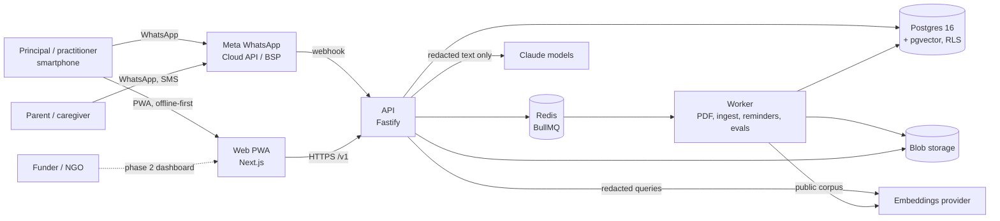
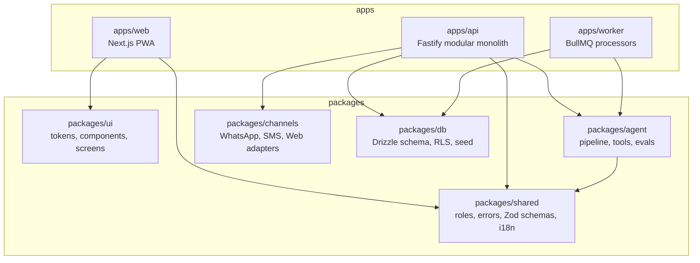
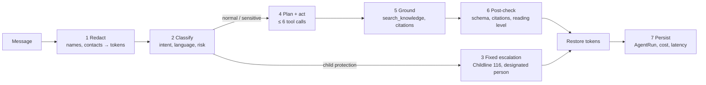
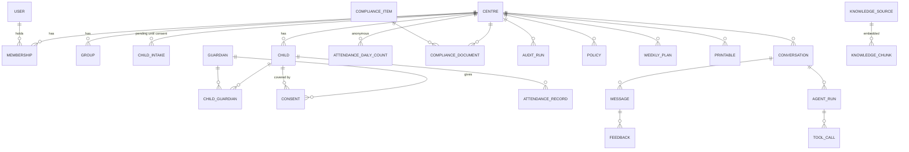

# Architecture

Polymath Wes is a modular monolith with a separate background worker, one Postgres database
and one AI agent shared by every channel. Decisions are recorded in [`adr/`](adr/).

## System context



## Containers and packages



## Request lifecycle (API)

```mermaid
sequenceDiagram
  participant C as Client (PWA / WhatsApp)
  participant A as API
  participant DB as Postgres (RLS)
  C->>A: POST /v1/... (Bearer JWT, Idempotency-Key)
  A->>A: request id, rate limit, Zod validation
  A->>A: auth: verify JWT, check membership + permission
  A->>DB: BEGIN; set_config(app.user_id, app.centre_id, app.role)
  A->>DB: queries (RLS filters rows)
  A->>DB: INSERT audit_log (child data access)
  A->>DB: COMMIT
  A-->>C: JSON, or ErrorEnvelope {code, message, requestId}
```

## Agent pipeline



The ordering is fixed in `runPipeline` (`packages/agent/src/pipeline.ts`), so a stage cannot
skip the safety gate.

## Data model

Core entities (full schema: `packages/db/src/schema`):



Notable choices:

- **Child:** pseudonymous UUID, first name, birth month (`YYYY-MM`), group. No surname, no ID number.
- **ChildIntake:** a child is only an intake until a guardian consents (ADR-0003, privacy.md).
- **AttendanceDailyCount:** anonymous headcounts kept when a child's records are deleted, so
  subsidy evidence survives consent withdrawal (pending decision #2).
- **Guardian phone:** encrypted with a blind index (ADR-0007).
- **Messages** are stored redacted, the same text the model saw.

## Frontend

- Next.js App Router; screens live in `@wes/ui` and are composed by thin pages, so Storybook and
  the app render identical components.
- Tailwind CSS 4 utilities map to semantic tokens (`bg-canvas`, `text-ink`, `bg-primary`), so light
  and dark themes need no `dark:` variants.
- Serwist service worker; Dexie outbox for offline writes (ADR-0005).
- Performance budget: first-load JS under 170 KB gzip per route, checked in CI
  (`apps/web/scripts/check-bundle.mjs`). Milestone 0: about 113 KB.
