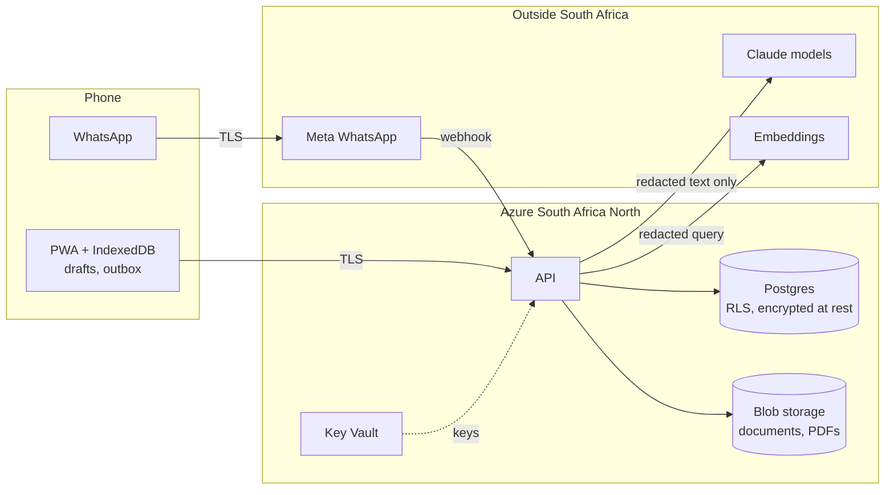

# Privacy and POPIA (draft)

> Draft for review by Dala Integrated Systems and a POPIA adviser. Not legal advice.

## Principles in the product

| POPIA condition                    | How Wes applies it                                                                                                 |
| ---------------------------------- | ------------------------------------------------------------------------------------------------------------------ |
| Accountability                     | Dala is the operator for centres (responsible parties); this document plus a data processing agreement per centre. |
| Processing limitation / minimality | Child: first name, birth month, group. No surname, ID number, address or photo by default.                         |
| Purpose specification              | Consent is per purpose: `child_record`, `progress_tracking`, `photos`, `parent_messages`.                          |
| Further processing                 | Child data is never used to train models. Analytics use anonymous counts.                                          |
| Information quality                | Practitioners can correct records; guardians can ask the centre to.                                                |
| Openness                           | Plain-language privacy notice in the app and on WhatsApp, in four languages (Milestone 1).                         |
| Security safeguards                | TLS, encryption at rest, field encryption for guardian phones, RLS per centre, audit log, least privilege.         |
| Data subject participation         | Export and deletion on request; consent withdrawal deletes child records.                                          |
| Children (s34–35)                  | Processing children's information only with a competent person's (guardian's) consent.                             |
| Cross-border (s72)                 | AI provider calls carry no direct identifiers (redaction). Basis documented below.                                 |

## Consent flow

1. A practitioner starts an **intake** (first name, birth month, group, guardian name and phone).
   An intake is not a child record and expires after 14 days.
2. The guardian consents by **one-time PIN on their own phone** (WhatsApp/SMS), or the
   practitioner uploads a **photo of the signed paper form**.
3. Only then is the `children` row created, linked to the consent.
4. **Withdrawal:** the guardian (or centre on their behalf) revokes consent. The child, their
   guardian links and per-day attendance are deleted. What remains: the consent row (no name),
   the audit trail, and anonymous daily headcounts used for subsidy claims.

> Pending decision #2: confirm anonymous headcounts may be kept after withdrawal.

## Data flow

**What reaches the AI provider:** message text after redaction. Child and guardian names, phone
numbers and other contact details are replaced with tokens like `⟦CHILD_1⟧` before the call.
The mapping stays on our servers. Centre names are allowed; child data is not.

**What reaches Meta:** WhatsApp messages exchanged with users of that channel, as with any
WhatsApp conversation. We avoid sending child names in templates.

## Draft record of processing activities

| Activity                     | Data subjects             | Categories                     | Purpose                            | Lawful basis                                        | Retention                                                | Recipients                                           |
| ---------------------------- | ------------------------- | ------------------------------ | ---------------------------------- | --------------------------------------------------- | -------------------------------------------------------- | ---------------------------------------------------- |
| Account and sign-in          | Staff, guardians, funders | Phone, display name, language  | Authentication                     | Contract / legitimate interest                      | Account life + 90 days                                   | —                                                    |
| Child register               | Children                  | First name, birth month, group | Running the centre, subsidy claims | Guardian consent                                    | Until withdrawal or child leaves + 1 year (TODO confirm) | Centre staff                                         |
| Guardian contacts            | Guardians                 | Name, phone (encrypted)        | Contact, consent                   | Consent                                             | As child register                                        | Centre staff                                         |
| Attendance                   | Children                  | Daily present/absent           | Subsidy claims, safety             | Consent; legal obligation for claims (TODO confirm) | 5 years anonymous counts (TODO confirm)                  | Centre; funders see anonymous counts                 |
| Registration documents       | Centre, staff             | Certificates, policies         | DBE registration                   | Legitimate interest                                 | Until superseded + 1 year                                | Centre; DBE when the centre submits                  |
| Wes conversations            | Staff, guardians          | Redacted messages              | Assistant, quality                 | Legitimate interest                                 | 12 months                                                | AI provider (redacted, no retention where available) |
| Child-protection escalations | Children, staff           | Event log (no narrative)       | Safeguarding                       | Vital interest / legal obligation                   | TODO(legal)                                              | Designated person                                    |
| Audit log                    | Staff                     | Who accessed what, when        | Security, accountability           | Legal obligation                                    | 3 years                                                  | —                                                    |

## Open items

- Section 72 basis for AI and WhatsApp providers (consent vs. binding agreement) — legal review.
- Information Officer registration for Dala; DPA template for centres.
- Retention periods marked TODO above.
- Breach notification runbook (Milestone 7).
